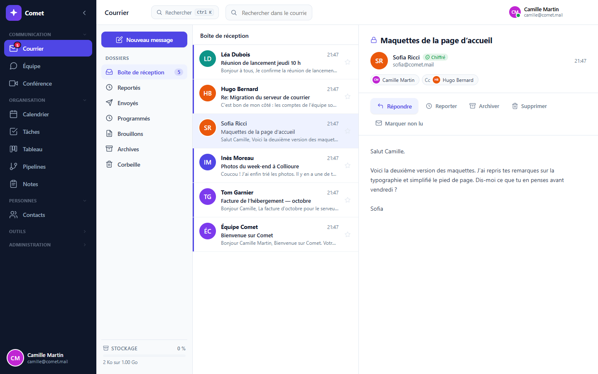
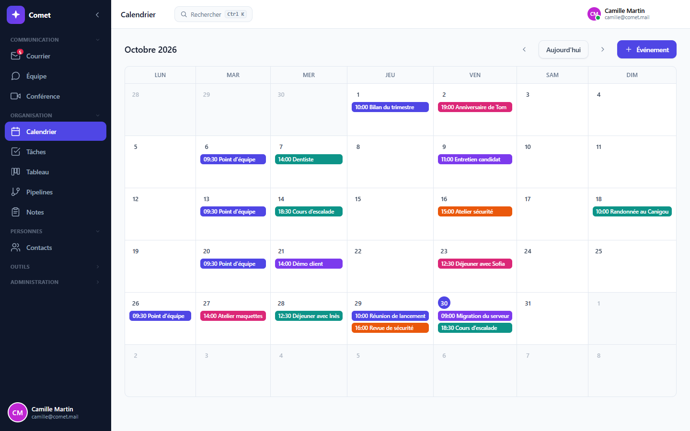
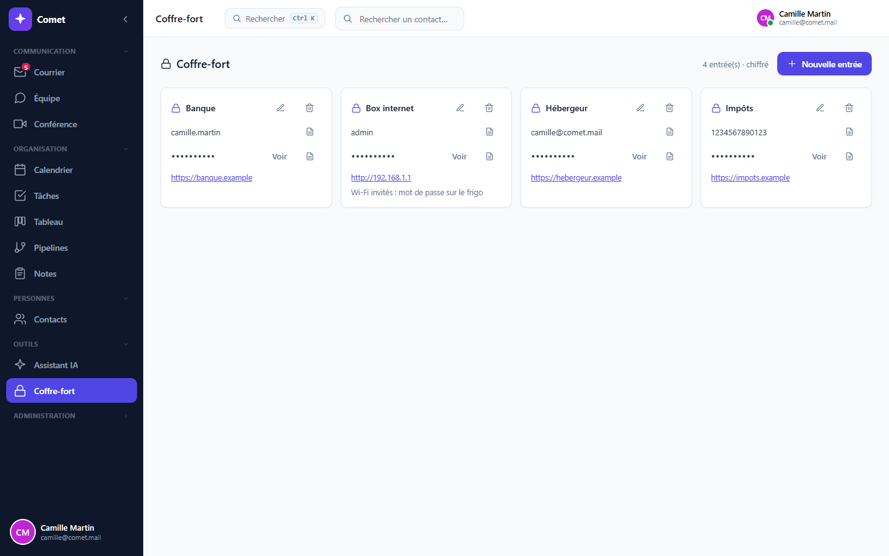

# Comet — serveur auto-hébergeable

*[English](README.md) · Français*

Comet est une suite de productivité que vous installez sur votre propre serveur :
courrier, messagerie d'équipe, conférence, calendrier, contacts, tâches, tableau,
pipelines, notes et coffre-fort. Le courrier entre comptes Comet, la messagerie d'équipe
et le coffre-fort sont **chiffrés de bout en bout** ; les autres outils ne le sont pas
encore (détails plus bas). Vos comptes, vos données et vos clés restent chez vous.

On l'utilise depuis un navigateur, ou depuis l'application de bureau (Windows, macOS,
Linux), qui se connecte au serveur de votre choix.



| Calendrier | Coffre-fort |
|---|---|
|  |  |

---

## Installer un serveur

### Avec Docker (le plus simple)

Il faut une machine allumée en permanence (un PC, un Raspberry Pi, un petit serveur
loué) avec [Docker](https://docs.docker.com/get-docker/).

```bash
git clone https://github.com/Plagnito/comet-server.git
cd comet-server
docker compose up -d
```

Le port Docker est limité à la machine locale par défaut. Sur le serveur, ouvrez
**http://localhost:4800**. Récupérez le code d'installation avec
`docker compose exec comet cat /comet/server/data/.bootstrap_token`, puis saisissez-le
pour créer le premier administrateur. Gardez ce code privé : l'API publique ne le
renvoie jamais. La base, les pièces jointes et les secrets restent dans le volume
Docker après une mise à jour. Depuis un autre ordinateur, utilisez un transfert SSH
local ou un relais HTTPS. Voir [installation et proxy](docs/bootstrap.md).

Une fois vos comptes créés, fermez les inscriptions dans `docker-compose.yml`
(`COMET_INSCRIPTION: fermee`), puis `docker compose up -d`.

Mettre à jour :

```bash
git pull && docker compose up -d --build
```

### Rendre le serveur joignable depuis Internet

Le serveur écoute en HTTP sur le port 4800. Pour s'y connecter de partout, il lui faut
une adresse en **HTTPS**. Deux façons courantes :

- **Tunnel Cloudflare** (aucun port à ouvrir sur votre box) : avec un nom de domaine
  géré par Cloudflare, `cloudflared tunnel` relie `https://comet.mon-domaine.fr` à
  `http://localhost:4800`.
- **Relais inverse** (Caddy, nginx) devant le port 4800, qui obtient le certificat
  HTTPS tout seul (Caddy : une ligne, `comet.mon-domaine.fr { reverse_proxy localhost:4800 }`).

Renseignez ensuite cette adresse dans `COMET_BASE_URL` (liens de partage, pièces jointes
volumineuses, connexion Gmail/Outlook).
Pour relayer l'IP du client, renseignez les IP/CIDR réels du proxy immédiat dans
`COMET_TRUST_PROXY`. Les en-têtes relayés sont ignorés par défaut ; les nombres de
sauts ne sont pas acceptés.

### Sans Docker

Il faut **Node.js 25 ou plus récent** (Comet utilise la base SQLite intégrée à Node).

```bash
cd client && npm ci && npm run build && cd ..
cd server && npm ci --omit=dev
cp .env.example .env      # puis renseignez au moins JWT_SECRET
npm start
```

---

## L'application de bureau

Au premier lancement, elle demande l'adresse de votre serveur, vérifie qu'il s'agit bien
d'un serveur Comet, puis la retient. On en change dans **Paramètres → Serveur**. Le HTTPS
est exigé, sauf sur le réseau local.

Pour l'instant, l'application se compile depuis ce dépôt : `npm install` à la racine,
puis `npm run dist` (installateurs dans `release/`).

---

## Ce qui est chiffré, et ce qui ne l'est pas

- **Chiffrés de bout en bout :** le courrier **entre comptes Comet** (objet et pièces
  jointes jusqu'à 50 Mo compris), du même serveur ou d'un autre serveur Comet (fédération,
  ci-dessous) ; la messagerie d'équipe, messages directs compris ; le coffre-fort. Les
  serveurs stockent et transportent ce contenu sans pouvoir le lire.
- **Pas encore chiffrés de bout en bout :** les notes, les contacts, les événements du
  calendrier, les tâches, le tableau et les pipelines. Ils sont stockés **en clair sur le
  serveur** : qui l'administre peut les lire. Hébergez votre propre serveur, ou utilisez
  celui d'un administrateur de confiance.
- **La visio** passe directement entre les navigateurs des participants (WebRTC, chiffré
  en transit) ; le serveur ne fait que les mettre en relation. Un relais TURN, si vous en
  installez un, transmet un flux qu'il ne peut pas déchiffrer.
- Votre **mot de passe est aussi votre clé de chiffrement**. S'il est perdu, le courrier
  chiffré l'est avec lui : aucun administrateur ne peut le récupérer. C'est le prix d'un
  serveur qui ne peut pas lire ce qu'il garde.
- Le courrier venu de l'extérieur (un compte Gmail ou Outlook relié à Comet) arrive en
  clair du réseau, comme partout ailleurs. Comet le signale sur chaque message concerné.
- Les fichiers de plus de 50 Mo sont transmis **non chiffrés** (hébergés par le serveur et
  partagés en torrent web-seed). L'interface prévient avant l'envoi.
- **Le serveur distribue les clés publiques, et un message n'est pas signé par son
  expéditeur.** Un serveur malveillant pourrait remettre sa propre clé à la place de celle
  d'un correspondant : comparez le **numéro de sécurité** (sur tout message d'un autre compte
  Comet, du même serveur ou non) avant de confier quelque chose de sensible.
- **Pas encore de confidentialité persistante :** les clés des comptes sont fixes ; qui
  obtiendrait plus tard la clé privée d'un compte lirait son courrier chiffré encore stocké.
  Détails et décisions (en anglais) : [`docs/security-model.md`](docs/security-model.md).

## Écrire aux autres serveurs Comet (fédération)

Posez `COMET_DOMAINE=comet.mon-domaine.fr` : vos comptes deviennent joignables depuis
n'importe quel autre serveur Comet sous `nom@comet.mon-domaine.fr`, et inversement.

- **Directement, sans intermédiaire** : votre serveur livre au serveur du destinataire,
  qu'il trouve à `https://<domaine>/.well-known/comet`. Aucun service central.
- **Chiffré de bout en bout** : votre application récupère la clé du destinataire auprès
  de SON serveur, qui l'atteste par une signature que l'application vérifie elle-même.
  Aucun des deux serveurs ne peut lire le message.
- **Les serveurs se reconnaissent** : chacun a une clé d'identité (Ed25519) et signe
  chaque requête. La clé d'un serveur est mémorisée au premier contact ; si elle change
  sans preuve signée par l'ancienne, les échanges sont suspendus jusqu'à ce que
  l'administrateur compare l'empreinte (page Administration).
- **Garde-fous** : anti-rejeu (date et nonce), limite de débit par serveur, liste de
  blocage, taille maximale, https obligatoire hors réseau local, aucune redirection suivie.
- **Numéro de sécurité** : sur un message venu d'un autre serveur, « Numéro de sécurité »
  affiche 60 chiffres identiques chez les deux correspondants. Comparez-les de vive voix :
  s'ils diffèrent, une clé a été substituée.

Ce que la fédération ne cache pas : les deux serveurs voient **qui écrit à qui, quand,
et la taille** des messages (comme pour l'e-mail). Tant que le numéro de sécurité n'a pas
été comparé, le premier contact repose sur le certificat https du serveur distant.

Détails du protocole : [`server/src/federation/PROTOCOLE.md`](server/src/federation/PROTOCOLE.md).

## Ce que cette édition ne fait pas encore

- **Les outils d'organisation** (annuaire d'entreprise, projets, objectifs, suivi du temps,
  rapports) supposent une gestion des organisations qui n'existe pas encore ici : ils sont
  masqués.
- **Entre serveurs Comet** : pas encore de pièces jointes, d'envoi programmé ni de
  messages éphémères (le texte, les réponses et les copies fonctionnent).
- **Mot de passe oublié** : pas de réinitialisation (voir plus haut).
- **Chiffrement de bout en bout** des notes, contacts, calendrier, tâches, tableau et pipelines.

---

## Configuration

Tout est décrit dans [`server/.env.example`](server/.env.example) : inscriptions, adresse
publique, comptes Gmail/Outlook en un clic, serveur TURN pour la visio à travers Internet,
notifications bureau. Rien n'est obligatoire avec Docker.

## Développement

```bash
npm run install:all   # dépendances racine, serveur et client
npm run dev           # serveur (4800) + interface Vite (5174)
cd server && npm test
```

Serveur : Node.js, Express, `node:sqlite`. Interface : React 18 et Vite. Bureau : Electron.

## Licence

Comet est publié sous **GNU AGPL v3** (voir [`LICENSE`](LICENSE)). Vous pouvez l'utiliser,
le modifier et l'héberger librement ; si vous proposez une version modifiée à d'autres
personnes à travers un réseau, vous devez leur en donner le code source.

Créé par Plagnito.
