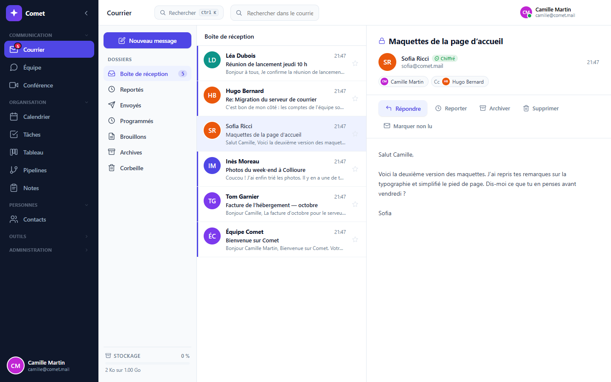
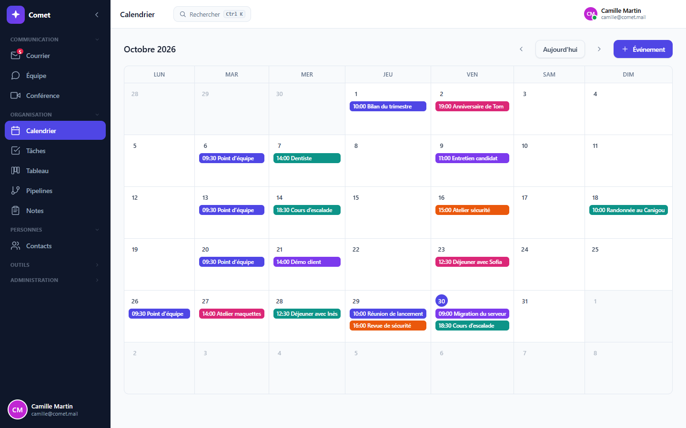
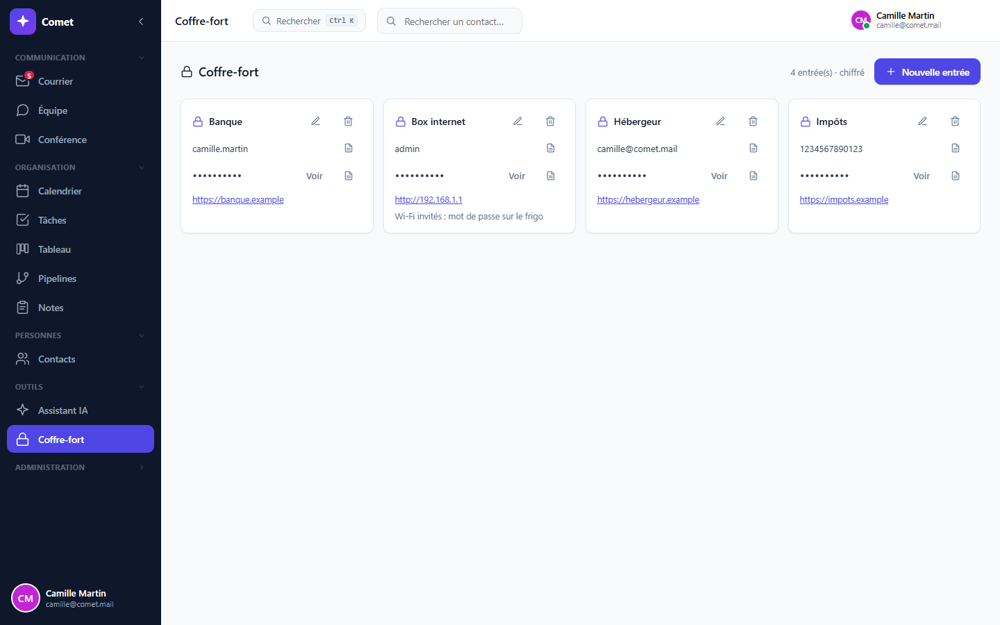

# Comet — a self-hosted, end-to-end encrypted productivity suite

*English · [Français](README.fr.md)*

Comet puts mail, team chat, video calls, a calendar, contacts, tasks, boards, pipelines,
notes and a password vault in one server **you** run. Content is **encrypted end to end**:
it is encrypted on your device, and the server stores and relays data it cannot read. Your
accounts, your data and your keys stay with you.

Use it from any browser, or from the desktop app (Windows, macOS, Linux), which connects to
the server of your choice.



| Calendar | Password vault |
|---|---|
|  |  |

---

## Install a server

### With Docker (simplest)

You need a machine that stays on (a PC, a Raspberry Pi, a small rented server) with
[Docker](https://docs.docker.com/get-docker/).

```bash
git clone https://github.com/Plagnito/comet-server.git
cd comet-server
docker compose up -d
```

The Docker port is bound to loopback by default. On the server, open
**http://localhost:4800**. Retrieve the installation code with
`docker compose exec comet cat /comet/server/data/.bootstrap_token`, then enter it
when creating the first administrator. Keep that code private; it is never sent by
the public API. The database, attachment storage and secrets are kept in the Docker
volume across updates. For setup from another computer, use a local SSH forward or
an HTTPS reverse proxy. See [setup and proxy configuration](docs/bootstrap.md).

Once your accounts exist, close sign-ups in `docker-compose.yml`
(`COMET_INSCRIPTION: fermee`), then run `docker compose up -d` again.

Update:

```bash
git pull && docker compose up -d --build
```

### Reach your server from the Internet

The server speaks plain HTTP on port 4800. To use it from anywhere it needs an **HTTPS**
address (browsers only allow the encryption APIs on secure origins). Two common options:

- **Cloudflare Tunnel** (no port to open on your router): with a domain managed by
  Cloudflare, `cloudflared tunnel` maps `https://comet.example.com` to `http://localhost:4800`.
- **A reverse proxy** (Caddy, nginx) in front of port 4800 that obtains the certificate by
  itself (Caddy, one line: `comet.example.com { reverse_proxy localhost:4800 }`).

Then put that address in `COMET_BASE_URL` (share links, large attachments, Gmail/Outlook
sign-in).
If client IP forwarding is needed, set `COMET_TRUST_PROXY` to the immediate proxy's
actual IP/CIDR. Forwarded headers are ignored by default; a hop count is not accepted.

### Without Docker

You need **Node.js 25 or newer** (Comet uses Node's built-in SQLite).

```bash
cd client && npm ci && npm run build && cd ..
cd server && npm ci --omit=dev
cp .env.example .env      # then set at least JWT_SECRET
npm start
```

---

## The desktop app

On first launch it asks for your server's address, checks that it really is a Comet server,
and remembers it. Change it later in **Settings → Server**. HTTPS is required except on the
local network.

For now the app is built from this repository: `npm install` at the root, then
`npm run dist` (installers land in `release/`).

---

## What is encrypted, and what is not

- Messages **between Comet accounts** — on the same server or on another Comet server
  (federation, below) — are end-to-end encrypted: servers store and carry content they
  cannot read.
- **Your password is also your encryption key.** If it is lost, your encrypted mail is lost
  with it: no administrator can recover it. That is the price of a server that cannot read
  what it keeps.
- Mail from outside (a Gmail or Outlook account linked to Comet) arrives in clear text from
  the network, as it does everywhere else. Comet flags every such message.
- Files larger than 50 MB are sent **unencrypted** (hosted by the server and shared as a
  web-seeded torrent). The interface warns you before sending.

## Writing to other Comet servers (federation)

Set `COMET_DOMAINE=comet.example.com`: your accounts become reachable from any other Comet
server as `name@comet.example.com`, and the other way round.

- **Direct, no middleman**: your server delivers to the recipient's server, which it finds
  at `https://<domain>/.well-known/comet`. There is no central service.
- **End-to-end encrypted**: your app fetches the recipient's key from *their* server, which
  vouches for it with a signature that the app verifies itself. Neither server can read the
  message.
- **Servers recognise each other**: each has an identity key (Ed25519) and signs every
  request. A server's key is remembered on first contact; if it changes without proof signed
  by the old key, exchanges are paused until the administrator compares fingerprints
  (Administration page).
- **Safeguards**: replay protection (date and nonce), per-server rate limits, a block list,
  a maximum size, HTTPS required outside the local network, no redirects followed.
- **Safety number**: on a message from another server, "Safety number" shows 60 digits that
  are identical on both sides. Compare them out loud: if they differ, a key was swapped.

What federation does not hide: both servers see **who writes to whom, when, and the size**
of messages (as with email). Until the safety number has been compared, first contact relies
on the remote server's HTTPS certificate.

Protocol details (in French): [`server/src/federation/PROTOCOLE.md`](server/src/federation/PROTOCOLE.md).

## Not there yet

- **Organisation tools** (company directory, projects, objectives, time tracking, reports)
  rely on organisation management that does not exist in this edition yet: they are hidden.
- **Between Comet servers**: no attachments, scheduled sending or disappearing messages yet
  (text, replies and copies work).
- **Forgotten password**: no reset (see above).
- **Language**: the interface is in French for now.

---

## Configuration

Everything is described in [`server/.env.example`](server/.env.example): sign-ups, public
address, one-click Gmail/Outlook accounts, a TURN server for video across the Internet,
desktop notifications. With Docker nothing is mandatory.

## Development

```bash
npm run install:all   # root, server and client dependencies
npm run dev           # server (4800) + Vite UI (5174)
cd server && npm test
```

Server: Node.js, Express, `node:sqlite`. Interface: React 18 and Vite. Desktop: Electron.

## License

Comet is released under the **GNU AGPL v3** (see [`LICENSE`](LICENSE)). You may use, modify
and host it freely; if you offer a modified version to other people over a network, you must
give them its source code.

Created by Plagnito.
